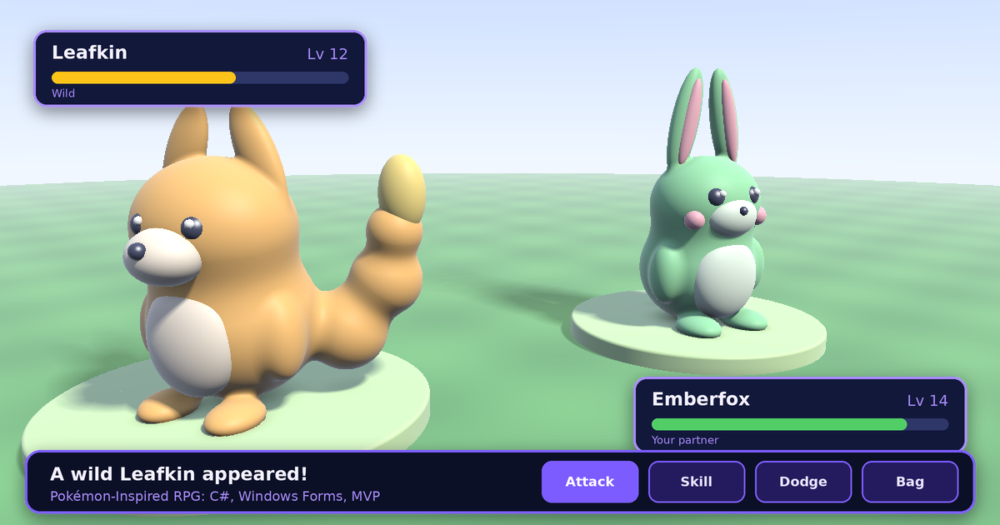

<div align="center">



# Pokémon Game: Final Project

**A Pokémon-inspired RPG with an explorable overworld, turn-based battles, an inventory, and save/restore. Built in C# for an Object-Oriented Programming course.**


</div>

---

## Table of Contents

- [Overview](#overview)
- [Features](#features)
- [Screenshots](#screenshots)
- [Getting Started](#getting-started)
- [Controls](#controls)
- [How to Play](#how-to-play)
- [Architecture](#architecture)
- [Project Structure](#project-structure)
- [Known Issues](#known-issues)
- [Roadmap](#roadmap)
- [Credits](#credits)

## Overview

This game was my final project for the Object-Oriented Programming subject. The goal was to apply OOP principles (encapsulation, abstraction, separation of concerns) and design patterns in a project big enough to need them. You walk around a top-down map, run into wild Pokémon, and fight them in turn-based battles where you can attack, use skills, or dodge.

## Features

| Feature | What it does |
| --- | --- |
| **Overworld exploration** | Move your character around the map, with collision detection against walls |
| **Wild encounters** | Walk into a wild Pokémon area to start a battle |
| **Turn-based battles** | Attack, use skills, or dodge, with a computer-controlled opponent |
| **Inventory** | Use power-ups to boost damage, recover health, and equip items |
| **Save and restore** | Save your state during a battle and restore it if you get defeated |
| **Audio** | Background music and battle sound effects |

## Screenshots

The banner at the top is illustrative artwork of the battle flow, not a capture from the game. Add real gameplay captures to `docs/` and swap them in below.

| Overworld | Battle | Inventory |
| --- | --- | --- |
|  |  |  |

## Getting Started

### Requirements

- Windows (the game uses Windows Forms and Windows Media Player)
- Visual Studio with the **.NET desktop development** workload

### Run it

```bash
git clone https://github.com/JMacopio/pokemonGame-final-project-.git
```

1. Open `pokemonGame.sln` in Visual Studio.
2. Build the solution with `Ctrl+Shift+B`.
3. Run it with `F5`.

> **Audio not playing?** Some audio files are loaded from absolute paths like `C:\Users\User\source\repos\...`. Update those paths in `LandingPage.cs` and `Battle.cs` to point to your local copy of the project. See [Known Issues](#known-issues).

## Controls

| Key | Action |
| --- | --- |
| `W` or `↑` | Move up |
| `S` or `↓` | Move down |
| `A` or `←` | Move left |
| `D` or `→` | Move right |
| `Enter` | Interact and advance dialogue |

## How to Play

1. **Start screen:** launch the game from the startup form.
2. **Explore:** walk around the map. Walking into wild Pokémon or NPCs triggers events.
3. **Battle:** you and the opponent take turns. Use skills for extra damage, dodge incoming attacks, or try to catch the Pokémon when its health is low.
4. **Manage items:** open the inventory to boost damage, heal, or equip special balls.
5. **Save:** save your progress during a battle. If you are defeated, restore your last saved state.

## Architecture

The project follows the **Model-View-Presenter (MVP)** pattern, with a **Factory** for creating battle entities.

| Layer | Responsibility | Examples |
| --- | --- | --- |
| **Model** | Game data and state | `PlayerMovement`, `PlayerState` |
| **View** | WinForms screens, UI only | `StartUp`, `LandingPage`, `Battle`, `Battle2`, `Inventory` |
| **Presenter** | Game logic between model and view | `BattlePresenter`, `SecondBattlePresenter`, `InventoryPresenter`, `Movements` |
| **Factory** | Creates battle entities | `BattleForm`, `SecondBattleForm` |

### Key classes

| Class | Description |
| --- | --- |
| `PlayerMovement` | Handles keyboard input, movement, and wall collision detection |
| `PlayerState` | Stores player health and position for save and restore |
| `BattleForm` | Factory-created battle entity with attack and skill methods |
| `BattlePresenter` | Manages battle logic, turn order, and the computer opponent |
| `InventoryPresenter` | Applies power-ups, recovers health, and equips items |

## Project Structure

```
pokemonGame/
├── Factory/          # Factory pattern for creating battle entities
│   ├── BattleForm.cs
│   └── SecondBattleForm.cs
├── Model/            # Data and game logic models
│   ├── PlayerMovement.cs
│   └── PlayerState.cs
├── Presenter/        # Business logic and state management
│   ├── BattlePresenter.cs
│   ├── InventoryPresenter.cs
│   ├── Movements.cs
│   └── SecondBattlePresenter.cs
├── Views/            # User interface forms
│   ├── LandingPage.cs
│   ├── Battle.cs
│   ├── Battle2.cs
│   ├── Inventory.cs
│   └── StartUp.cs
├── Resources/        # Images, audio, and other assets
├── Properties/       # Assembly and resource settings
├── Program.cs        # Application entry point
└── pokemonGame.csproj
```

## Known Issues

- **Hard-coded audio paths.** Audio loads from absolute `C:\Users\User\...` paths, so music and sound effects only work on the original machine until the paths are changed.
- **Windows only.** Windows Forms and Windows Media Player tie the game to Windows.

## Roadmap

- [ ] Load audio from relative paths (for example, copy the audio files to the output folder and build the path from `Application.StartupPath`)
- [ ] Add real gameplay screenshots or a short GIF (the three image links above are waiting for `overworld.png`, `battle.png` and `inventory.png`)
- [ ] Add more wild Pokémon areas and battle forms
- [ ] Add a release build so the game can be played without Visual Studio

## Credits

- **Developer:** [JMacopio](https://github.com/JMacopio)
- **Purpose:** Final project for the Object-Oriented Programming subject
- **Assets:** Pokémon-inspired sprites and audio, used for educational purposes
- **Banner artwork:** original 3D-rendered creatures made for this README (`docs/banner.png`)

---

<sub>This project was created for educational purposes and is not affiliated with Nintendo or The Pokémon Company.</sub>
